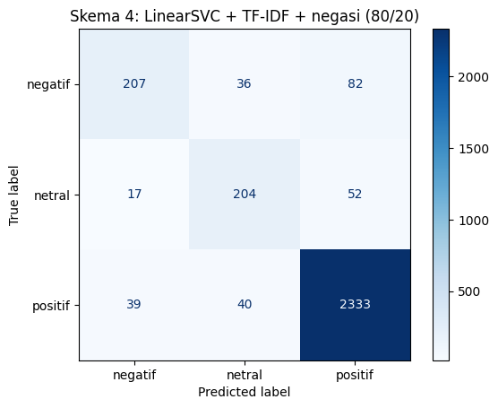
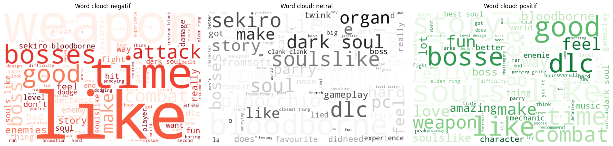

# Lies of P — Steam Review Sentiment Analysis

Three-class sentiment analysis (negative, neutral, positive) of **20,098 self-scraped English Steam reviews** of the soulslike game *Lies of P*. Four training schemes are compared, and a negation-tagging preprocessing step lifts a linear model to the best result.

## Results

| Scheme | Model | Features | Split | Train acc. | Test acc. |
|---|---|---|---|---|---|
| 1 | LinearSVC | TF-IDF | 80/20 | 98.35% | 89.70% |
| 2 | Logistic Regression | TF-IDF | 70/30 | 98.04% | 89.50% |
| 3 | BiLSTM | Learned word embedding | 80/20 | 97.16% | 88.87% |
| 4 | **LinearSVC** | **TF-IDF + negation tagging** | 80/20 | 99.23% | **91.16%** |

Majority-class baseline: 80.13%.



## Key finding

All three base models plateau at ~89–90% despite very different architectures. Error analysis shows the ceiling comes from the **labels, not the models**: accuracy is ~98% on reviews with a clear sentiment score, but only ~52% on reviews close to VADER's ±0.05 label threshold, where labels flip on tiny differences in word weights. On several of these reviews, the model's prediction matches human judgment better than the VADER label.

Negation tagging (e.g. `not good` → `not neg_good`) restores word-order information that TF-IDF loses, improving test accuracy by 1.46 points and negative-class recall from 55.4% to 63.7%.

## Dataset


- **Source:** Steam's official public review endpoint (`store.steampowered.com/appreviews/1627720`), with a 2-second delay between requests. No reviewer identities (SteamID, profile names) are stored.
- **Period:** July 2024 – October 2026 (most recent reviews at time of scraping).
- **Cleaning:** removed empty reviews, reviews under 3 words, duplicates, and non-English reviews → **15,047 reviews**.
- **Labeling:** automatic, using the VADER lexicon adapted to gaming slang (e.g. *peak*, *goated* as positive; *died*, *brutal*, and the *lies* in the game title as neutral).
- **Class distribution:** positive 80.1%, negative 10.8%, neutral 9.1%.

The dataset is **not included** in this repository because the review texts belong to their Steam authors. Run `notebooks/scraping_lies_of_p.ipynb` to collect a fresh copy (results may differ slightly as new reviews are posted).

## Repository structure

| Path | Contents |
|---|---|
| `notebooks/scraping_lies_of_p.ipynb` | Data collection with rate-limit handling and checkpointing |
| `notebooks/pelatihan_model_sentimen.ipynb` | EDA, cleaning, labeling, 4 training schemes with hyperparameter tuning, error analysis, inference |

Notebook explanations are written in Indonesian.

## How to run

```bash
pip install -r requirements.txt
```

1. Run `scraping_lies_of_p.ipynb` to produce `ulasan_lies_of_p.csv`.
2. Place the CSV next to `pelatihan_model_sentimen.ipynb` and run all cells (a GPU is recommended for the BiLSTM scheme).

See Section 11 of the training notebook for inference on new text.

## Limitations

- Labels come from a lexicon, so models learn to replicate VADER, not human sentiment directly. VADER misses sarcasm, memes, and idioms.
- Only English reviews from roughly the last two years; the launch period (September 2023) is not covered.
- Strong class imbalance toward positive reviews.

## License

Code is released under the [MIT License](LICENSE). Steam review texts are not covered by this license.
